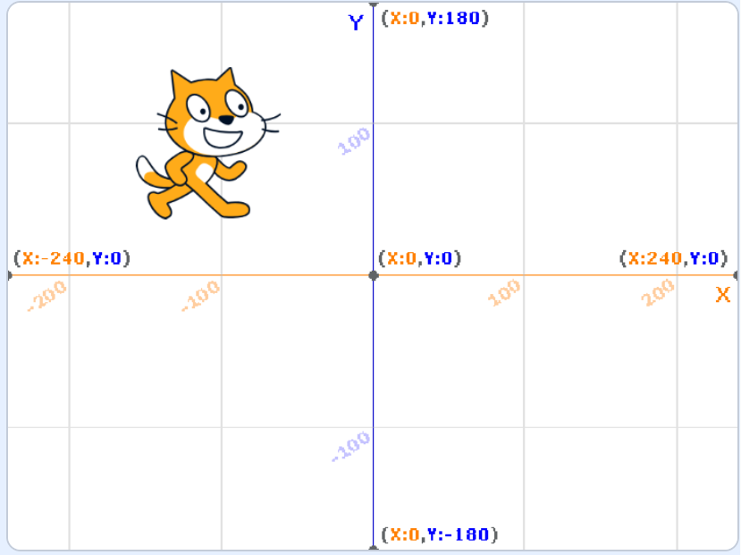

{cover}
# ① ネコを動かそう（動き）

向きと場所を、数字で決めよう

*Scratch 体験ワークショップ*

---

# なにをするの？

:::

青い「**動き**」のブロックで、ネコを思いどおりの場所に動かそう。

- ネコの**向き**を数字で決める
- ステージの**場所**を x と y であらわす
- 緑の旗で**スタートの位置**にもどす
- **すーっと**動かす

:::

📷 ここに画面：「動き」のブロックがならんでいるところ（ブロックのならぶところを上から下まで）

---

# 向きを変えよう

:::

1. 「**動き**」の「**90 度に向ける**」をコードエリアに置く
2. 白い丸のところをクリックして、数字を変える
3. ブロックをクリック

- **90** … 右
- **0** … 上
- **-90** … 左
- **180** … 下

> 白い丸をクリックすると、時計のような丸い目盛りも出るよ。矢印を回しても決められるんだ。

:::

📷 ここにブロックの画面：「90 度に向ける」の白い丸をクリックして、丸い目盛りが出ているところ

---

# ステージの場所は x と y

:::

ステージの場所は、**2つの数字**であらわすよ。

- **x** … 横の場所。右へ行くほど大きい（-240〜240）
- **y** … たての場所。上へ行くほど大きい（-180〜180）
- **まん中**は x が 0、y が 0

1. 右下の「**背景を選ぶ**」で「**Xy-grid**」をえらぶ
2. ネコをドラッグして、右下の「**x**」と「**y**」の数字が変わるのを見る

:::

---

# 場所を決めよう

:::

1. 「**動き**」の「**x座標を 0 、y座標を 0 にする**」を置く
2. 白い丸に数字を入れる（例：x に **100**、y に **50**）
3. ブロックをクリック

ネコが、その場所に**ワープ**するよ。

> ブロックのならぶところでは、いまネコがいる場所の数字が、はじめから入っているよ。

:::

📷 ここにブロックの画面：「x座標を 100 、y座標を 50 にする」と、ワープしたあとのステージ

---

# スタートの位置にもどそう

:::

i3 では、動いたネコを手でもどしたね。プログラムでもどそう。

1. 「**（緑の旗）が押されたとき**」を置く
2. 下に「**x座標を 0 、y座標を 0 にする**」をつなぐ
3. その下に「**90 度に向ける**」をつなぐ

> 作品のはじめに「場所」と「向き」を決めておくのは、よく使うワザだよ。これから何回も出てくるよ。

:::

📷 ここにブロックの画面：「緑の旗が押されたとき」→「x座標を 0 、y座標を 0 にする」→「90 度に向ける」のスクリプト

---

# 少しずつ動かそう

:::

いまの場所から、**少しだけ**動かすこともできるよ。

- 「**x座標を 10 ずつ変える**」… 右へ 10
- 「**y座標を 10 ずつ変える**」… 上へ 10

左や下へ動かしたいときは、**-10** のようにマイナスにするよ。

> 「10 歩動かす」は、ネコが向いている方へ進むブロック。こちらは、向きに関係なく右や上に動くよ。

:::

📷 ここにブロックの画面：「x座標を 10 ずつ変える」と「y座標を -10 ずつ変える」をならべたもの

---

# すーっと動かそう

:::

ワープではなく、**すべるように**動かすブロックもあるよ。

- 「**1 秒でどこかの場所へ行く**」
- 「**1 秒でx座標を 100 に、y座標を 50 に変える**」

秒の数を大きくすると、**ゆっくり**動くよ。

> 「どこかの場所」の ▼ をクリックすると、「**マウスのポインター**」もえらべるよ。

:::

📷 ここにブロックの画面：「1 秒でどこかの場所へ行く」の ▼ をひらいたところ

---

# やってみよう

:::

ネコに、ステージの**四すみ**を回らせよう。

1. 「スタートの位置にもどそう」のスクリプトを作る
2. 「**1 秒でx座標を … に、y座標を … に変える**」を4つつなぐ
3. 右上 → 右下 → 左下 → 左上 の順に回るように数字を入れる
4. 最後に、まん中にもどす
5. 秒の数を変えて、速さを変える

:::

📷 ここにブロックの画面：四すみを回るスクリプトの例（4つの「1 秒でx座標を…」がつながったもの）
