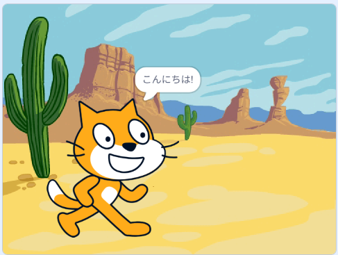
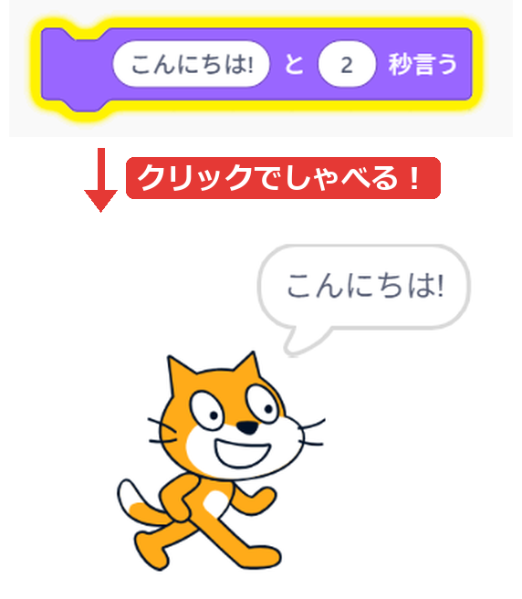
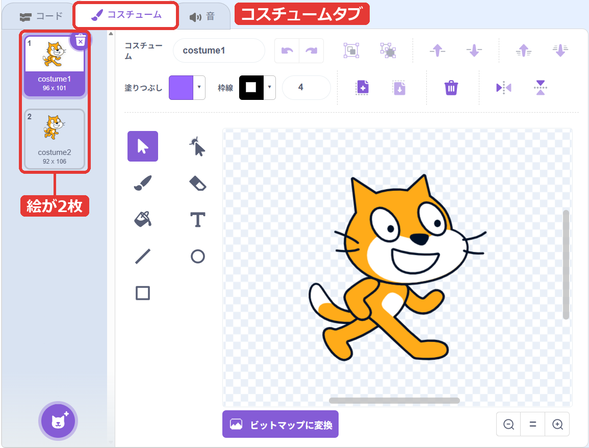
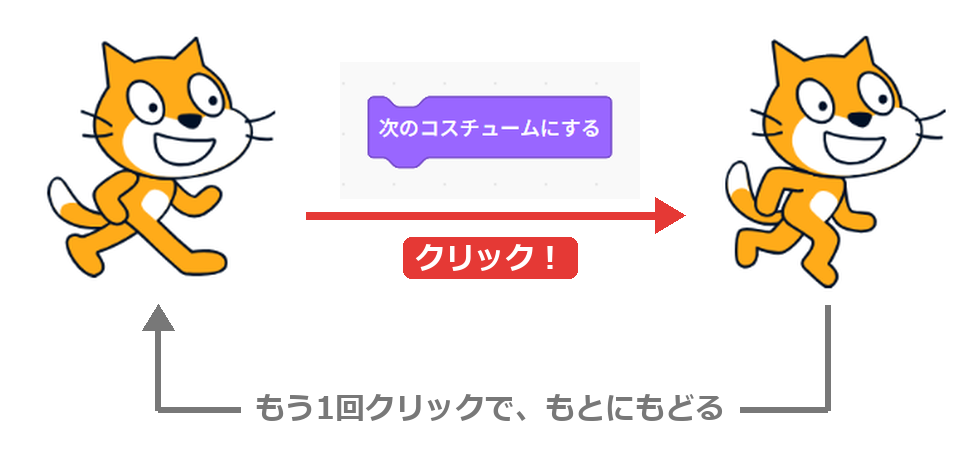
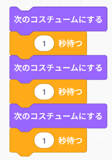
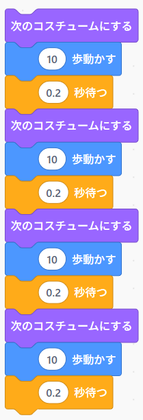
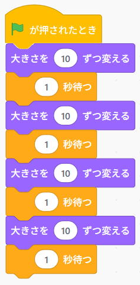
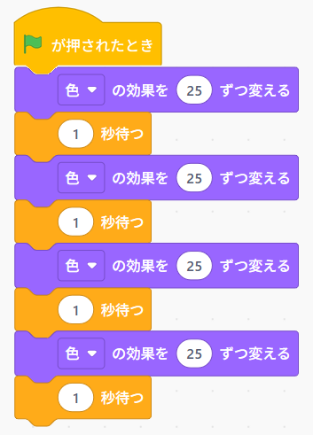
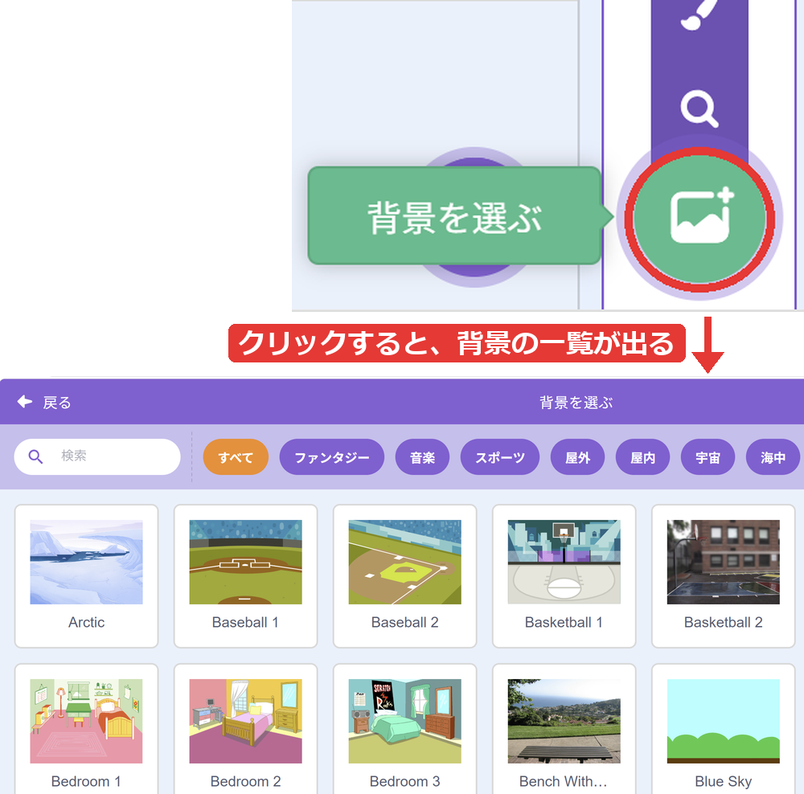
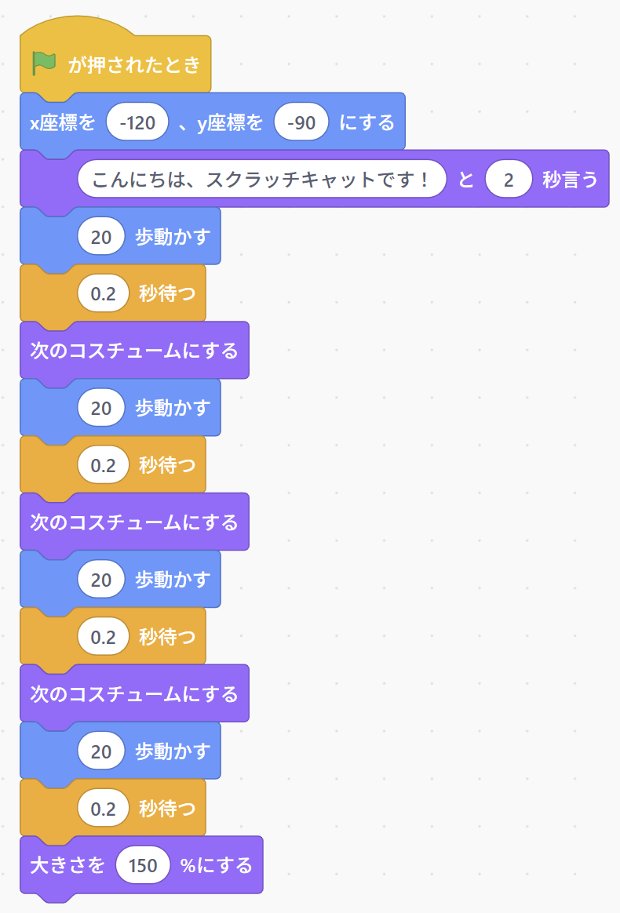

{cover}
# ② アニメーションしよう（見た目）

しゃべる・歩く・大きくなる

*Scratch 体験ワークショップ*

---

# なにをするの？

:::

むらさきの「**見た目**」のブロックで、ネコを生き生きさせよう。

- セリフを**しゃべらせる**
- **コスチューム**を切りかえて歩かせる
- **大きさ**や**色**を変える
- **背景**を変える

:::

---

# しゃべらせよう

:::

1. 「**見た目**」の「**こんにちは! と 2 秒言う**」を置く
2. 「こんにちは!」のところに、好きなことばを入れる
3. ブロックをクリック

「秒」がついていない「**こんにちは! と言う**」は、ずっと言いっぱなしになるよ。

> 「**うーん... と 2 秒考える**」にすると、もくもくの ふきだしで考えごとをするよ。

:::

---

# コスチュームってなに？

:::

**コスチューム**は、スプライトの「**絵**」のこと。

1. 左上の「**コスチューム**」タブをクリック
2. ネコには、**costume1** と **costume2** の**絵が2枚**ある
3. 1枚目と2枚目を、かわりばんこにクリックしてみる
4. 「**コード**」タブにもどる

> 足の形が少しちがうね。かわりばんこに見せると、歩いているように見えるんだ。

:::

---

# コスチュームを切りかえよう

:::

1. 「**見た目**」の「**次のコスチュームにする**」を置く
2. ブロックを何回もクリック

クリックするたびに、ネコの足が動くよ。

> 2枚目の次は、また1枚目にもどるよ。

:::

---

# 「待つ」ブロック

:::

「次のコスチュームにする」を2つつないでクリックすると……**何も変わらない**ように見えるね。

コンピューターは**速すぎて**、目で見えないんだ。

1. 「**制御**」の「**1 秒待つ**」をえらぶ
2. 「次のコスチュームにする」と「1 秒待つ」を、**交互に**3組つなぐ
3. クリックすると、1秒ごとに足の形が変わる

> 「**制御**」はオレンジのブロック。くわしくは制御編でおぼえるよ。

:::

---

# 歩いているように見せよう

:::

1. 「**次のコスチュームにする**」「**10 歩動かす**」「**1 秒待つ**」をつなぐ
2. 「1 秒待つ」の数字を **0.2** にする
3. いちばん上のブロックを**右クリック**して「**複製**」
4. 下につなげる。これを何回かくりかえす

> 同じブロックがならんで長いね。制御編で、これを**短くする方法**をおぼえるよ。

:::

---

# 大きさを変えよう

:::

- 「**大きさを 10 ずつ変える**」… 少しずつ大きく
- 「**大きさを 100 %にする**」… もとの大きさ

小さくしたいときは、**-10** のようにマイナスにするよ。

> 右下の「**大きさ**」の数字も、いっしょに変わるのを見てみよう。

:::

---

# 色を変えよう

:::

1. 「**色 の効果を 25 ずつ変える**」と「**1 秒待つ**」を、交互に4組つなぐ
2. クリックして、ネコがどうなるか見てみる
3. 「**画像効果をなくす**」をクリックすると、もとにもどる

> 「色」の ▼ からは「**魚眼レンズ**」「**渦巻き**」「**幽霊**」などもえらべるよ。

:::

---

# 背景を変えよう

:::

1. 右下の「**ステージ**」の下にある「**背景を選ぶ**」をクリック
2. 好きな背景をえらぶ

ステージの絵が変わったね。

> 背景はいくつでもふやせるよ。「**見た目**」の「**背景を … にする**」で、プログラムからも切りかえられるんだ。

:::

---

# 🎮 ミニゲーム：何回で元の色？

**🔮 予想** … 先に予想してから、たしかめよう！

「**色 の効果を 25 ずつ変える**」を**何回**クリックすると、ネコが**もとの色**にもどるかな？

1. 「**画像効果をなくす**」をクリックして、ネコをもとの色にしておく
2. 予想した回数を、となりの人に言う
3. 「**色 の効果を 25 ずつ変える**」をクリックしながら、回数を数える
4. もとの色にもどったら、ストップ！

> 予想がいちばん近かった人の勝ち！ 数字を 25 から 50 に変えたら、何回になるかな？

---

# やってみよう

:::

ネコに、**自己紹介**をさせよう。

1. 好きな背景をえらぶ
2. 緑の旗で、スタートの場所にもどす
3. 「**こんにちは! と 2 秒言う**」で名前を言う
4. 歩くスクリプトで、少し歩く
5. 最後に、大きくなったり色が変わったりする

:::

