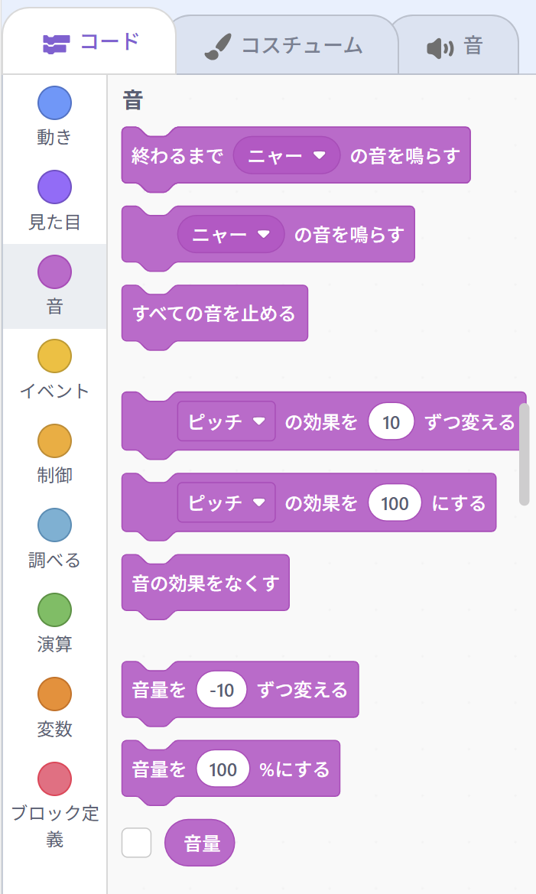
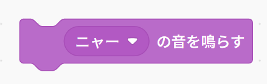
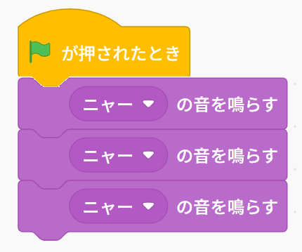
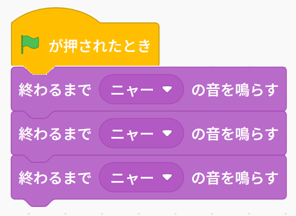
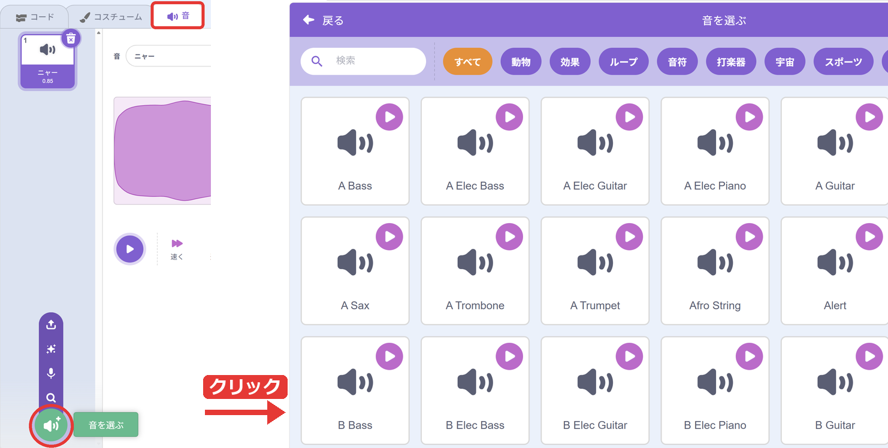
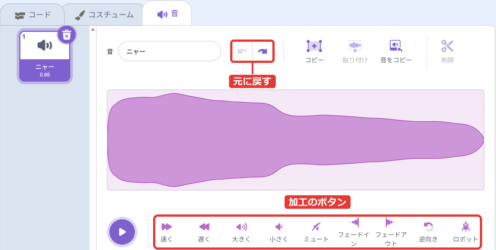
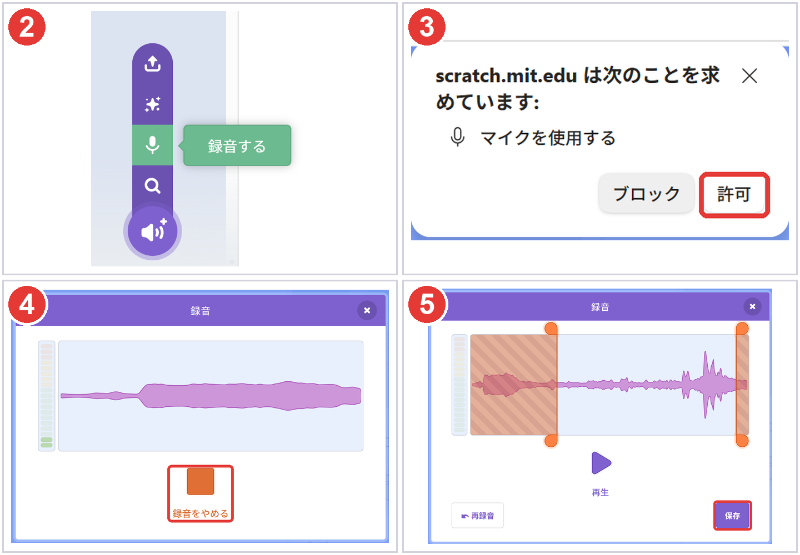
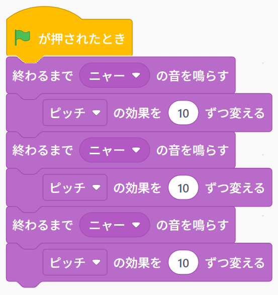
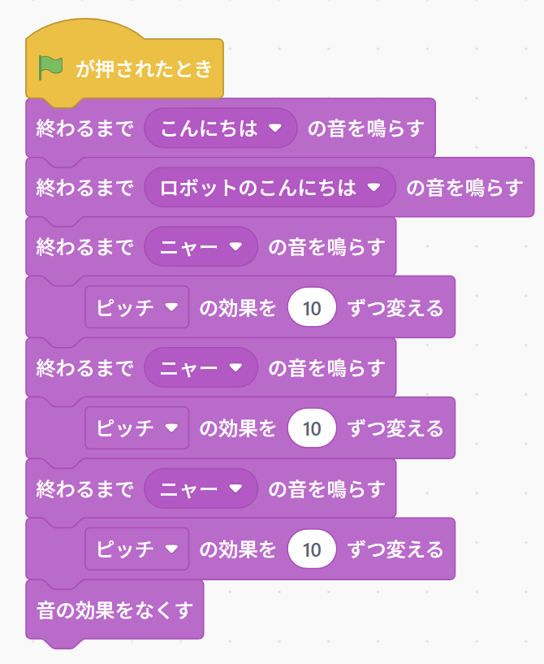

{cover}
# ③ 音を鳴らそう（音）

鳴らす・えらぶ・録音する

*Scratch 体験ワークショップ*

---

# なにをするの？

:::

ピンクの「**音**」のブロックで、作品に音をつけよう。

- ネコを**鳴かせる**
- いろいろな音を**えらぶ**
- 音を**加工**する・自分の声を**録音**する
- 音の**高さ**を変える

> ⚠ まわりの人のじゃまにならないように、音の大きさに気をつけてね。

:::

---

# ニャーと鳴かせよう

:::

1. 「**音**」の「**ニャー の音を鳴らす**」を置く
2. ブロックをクリック
3. ネコが「ニャー」と鳴いたら成功！

> 音が聞こえないときは、パソコンの音量がゼロになっていないか、メンターといっしょにたしかめよう。

:::

---

# 2つの「鳴らす」のちがい

:::

「鳴らす」ブロックは**2つ**あるよ。緑の旗の下に、それぞれ**3つ**つないでくらべてみよう。

- 「**ニャー の音を鳴らす**」… 3つつなぐと、**何回**聞こえるかな？
- 「**終わるまで ニャー の音を鳴らす**」… こちらは**何回**？

先に予想してから、緑の旗をクリックしてたしかめよう。

> 音を順番に鳴らしたいときは「**終わるまで**」を使おう。

:::

---

# 音をふやそう

:::

1. 左上の「**音**」タブをクリック
2. 左下の「**音を選ぶ**」をクリック
3. ▶ を押すと、音をためしに聞ける
4. 好きな音をクリック
5. 「**コード**」タブにもどり、「ニャー」の ▼ から、えらんだ音にする

:::

---

# 音を加工しよう

:::

「**音**」タブでは、音を作りかえられるよ。下のボタンを押してみよう。

- 「**速く**」「**遅く**」… 速さと高さが変わる
- 「**大きく**」「**小さく**」… 音の大きさが変わる
- 「**ロボット**」… ロボットの声に
- 「**逆向き**」… うしろから再生

> もとにもどしたいときは「**元に戻す**」を押してね。

:::

---

# 自分の声を録音しよう

:::

1. 「**音を選ぶ**」にマウスをのせる
2. 出てきたメニューの「**録音する**」をクリック
3. 左上に「マイクを使用する」と出たら「**許可**」
4. 「**録音する**」を押してしゃべり、「**録音をやめる**」
5. 「**保存**」を押す

> ⚠ まちがえて「ブロック」を押すと録音できないよ。そのときはメンターをよんでね。

:::

---

# 音の高さを変えよう

:::

ブロックで、音の高さや大きさを変えられるよ。

- 「**ピッチ の効果を 10 ずつ変える**」… 音が高くなる
- 「**音の効果をなくす**」… もとの高さにもどす
- 「**音量を 100 %にする**」… 大きさを決める

> 右の図のように交互につなぐと、どんなふうに聞こえるかな？ 緑の旗をクリックしてたしかめよう。

:::

---

# 🎮 ミニゲーム：さかさま言葉あて

**⚔ 勝負** … となりの人と、出しあいっこしよう！

1. 3〜4文字のことばを、自分の声で録音する（例：すいか、ひまわり）
2. 「**逆向き**」を押して、うしろから再生する音にする
3. となりの人に聞かせて、何と言ったか当ててもらう
4. 当たったら1点。交代して出しあう

> ⚠ だれかの名前や悪口は録音しないでね。みんなが楽しめることばにしよう。

---

# やってみよう

:::

音で、ネコの**おしゃべり**を作ろう。

1. 自分の声で「こんにちは」を録音する
2. 緑の旗で、録音した声を「**終わるまで**」鳴らす
3. 「**ロボット**」で加工した声も鳴らす
4. 最後に、だんだん高くなる「ニャー」を3回鳴らす
5. 「**音の効果をなくす**」で、もとにもどしておく

> 録音した音は、「**音**」タブの名前の欄で名前を変えられるよ。

:::

