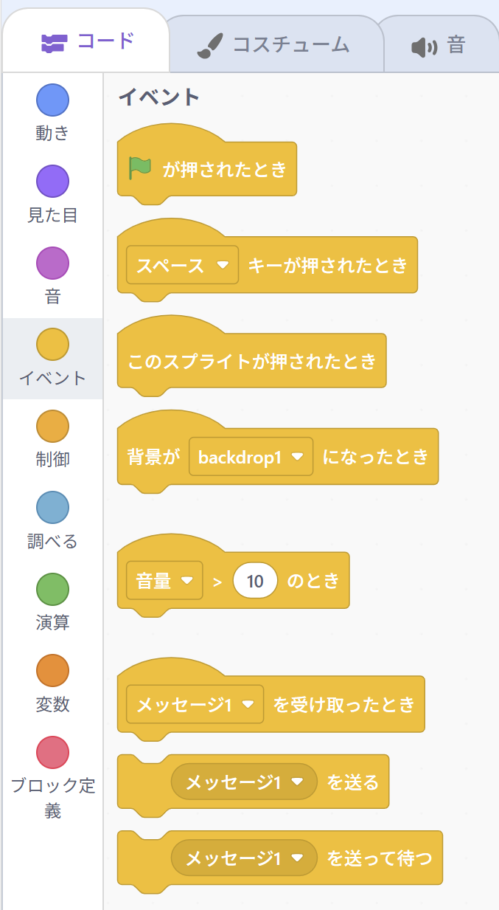
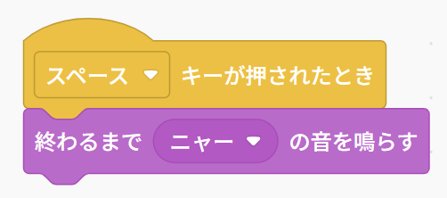
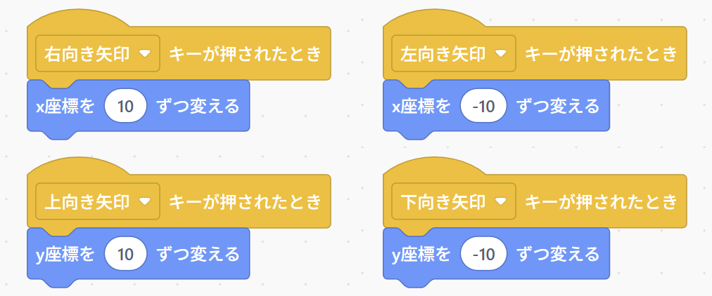
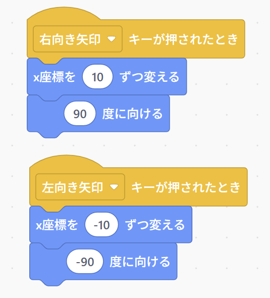
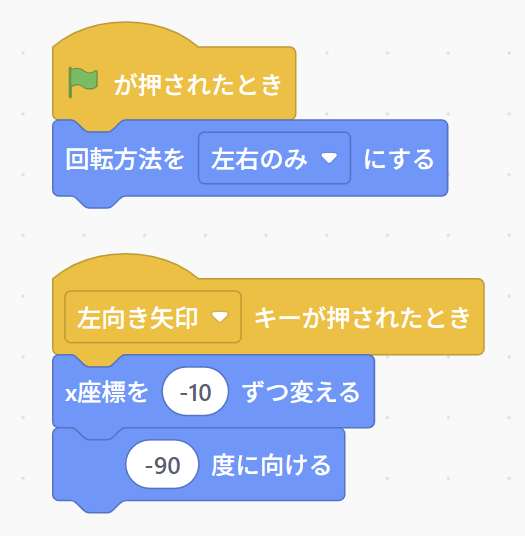
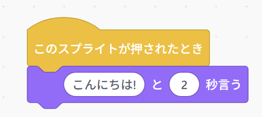
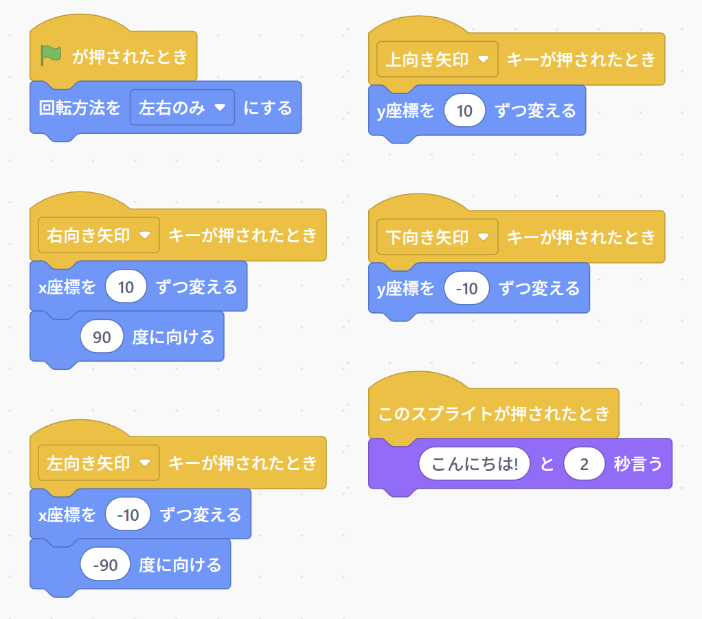
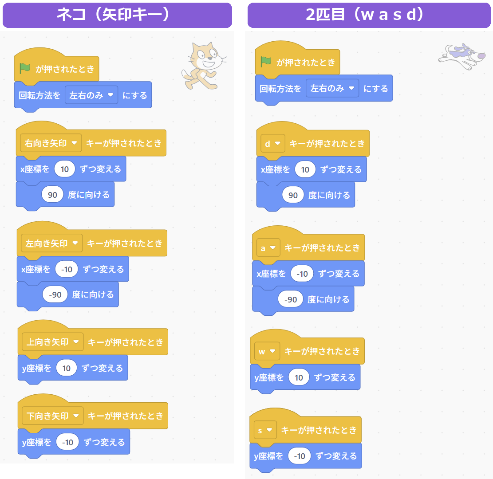
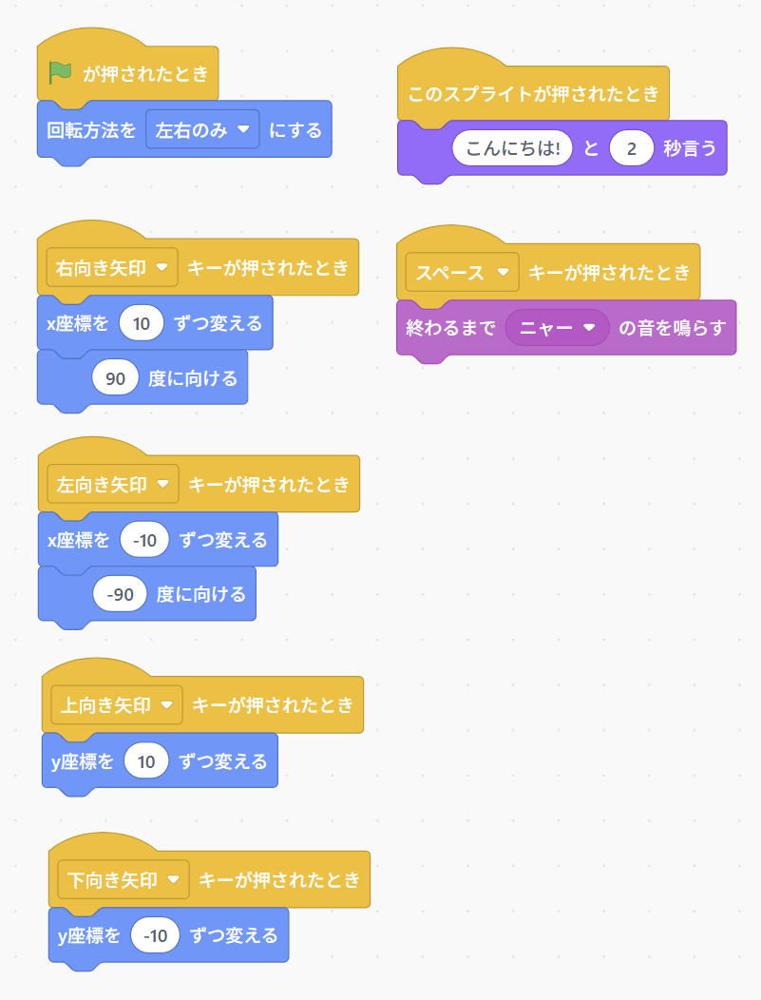

{cover}
# ④ キーでそうさしよう（イベント）

キーボードとマウスで、ネコをあやつろう

*Scratch 体験ワークショップ*

---

# なにをするの？

:::

黄色い「**イベント**」のブロックは、プログラムをスタートする**合図**。

緑の旗のほかにも、いろいろな合図があるよ。

- **キー**を押したとき
- **スプライト**をクリックしたとき

> この章ができると、ゲームのように**自分でそうさ**できるようになるよ。

:::

---

# キーで動かそう

:::

1. 「**イベント**」の「**スペース キーが押されたとき**」を置く
2. 下に「**終わるまで ニャー の音を鳴らす**」をつなぐ
3. キーボードの**スペースキー**を押す
4. 「スペース」の ▼ をクリックして、ほかのキーにも変えてみる

▼ では、矢印キーや a〜z のキーもえらべるよ。

> ⚠ キーがきかないときは、ステージを1回クリックしてから押してみよう。

:::

---

# 矢印キーで上下左右

:::

4つのスクリプトを作ろう。

- 「**右向き矢印 キーが押されたとき**」→「**x座標を 10 ずつ変える**」
- 「**左向き矢印 キーが押されたとき**」→「**x座標を -10 ずつ変える**」
- 「**上向き矢印 キーが押されたとき**」→「**y座標を 10 ずつ変える**」
- 「**下向き矢印 キーが押されたとき**」→「**y座標を -10 ずつ変える**」

> キーを押しっぱなしにすると、続けて動くよ。

:::

---

# 進む向きを向かせよう

:::

左へ進むときは、ネコも**左を向いて**ほしいね。

1. 右向き矢印のスクリプトに「**90 度に向ける**」をつなぐ
2. 左向き矢印のスクリプトに「**-90 度に向ける**」をつなぐ
3. 左向き矢印キーを押して、ネコのようすを見てみよう

あれれ？ ネコのようすが、なんだかへんだね…

:::

---

# さかさまを直そう

:::

ネコは、向きに合わせて**ぐるっと回転**しているんだ。

1. 「**動き**」の「**回転方法を 左右のみ にする**」をえらぶ
2. 緑の旗のスクリプトにつなぐ
3. 緑の旗をクリックしてから、左向き矢印キーを押す

> 「**左右のみ**」にすると、ネコは右か左しか向かなくなるよ。▼ で「**回転しない**」もえらべるよ。

:::

---

# クリックで動かそう

:::

ネコを**マウスでクリック**したときにも、動かせるよ。

1. 「**このスプライトが押されたとき**」を置く
2. 下に「**こんにちは! と 2 秒言う**」をつなぐ
3. ステージのネコをクリック

> ネコ以外の場所をクリックしても、何も起きないよ。

:::

---

# スクリプトは何本でもOK

:::

1つのスプライトに、スクリプトが**何本**あってもいいんだ。

- 合図がくると、**そのスクリプトだけ**が動く
- 合図がちがえば、おたがいにじゃましない

> コードエリアがごちゃごちゃしたら、何もないところを右クリックして「**きれいにする**」。きれいにならぶよ。

:::

---

# 🎮 ミニゲーム：2人で鬼ごっこ

:::

**🏃 追いかけ** … 1台のパソコンで、2人で遊ぼう！

1. 「**スプライトを選ぶ**」で、2匹目のスプライトを出す
2. 2匹目に、**w**（上）**a**（左）**s**（下）**d**（右）キーで動くスクリプトを作る
3. ネコは矢印キー、2匹目は w a s d キーでそうさする
4. 鬼を決めて、30秒で**タッチ**できたら鬼の勝ち（タッチは2人で見て決める）

> ⚠ 2人が同時に押しっぱなしにすると、片方しか動かないよ。キーは**トントン**と押そう。直し方は制御編でおぼえるよ。

:::

---

# やってみよう

:::

キーとマウスで、ネコをあやつろう。

1. 矢印キーで、ネコを上下左右に動かす
2. 左右で、進む方を向くようにする
3. ネコをクリックしたら、しゃべるようにする
4. スペースキーで、ニャーと鳴くようにする

:::

