{cover}
# ① くりかえそう

同じ動きは、くりかえしにおまかせ

*Scratch 体験ワークショップ*

---

# なにをするの？

:::

オレンジの「**制御**」のブロックで、同じ動きを何回もさせよう。

- 「**10 回繰り返す**」で、決めた回数だけくりかえす
- 「**ずっと**」で、止めるまでくりかえす
- ネコがマウスを**追いかけてくる**ゲームを作る
- 作品を**パソコンに保存**する

:::

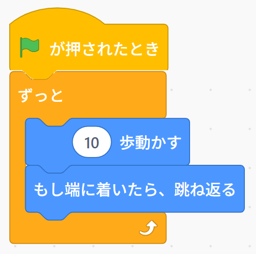

---

# 長いプログラムを短くしよう

:::

b2 で作った歩くスクリプト、同じブロックがならんで長かったね。

1. 「**制御**」の「**10 回繰り返す**」をえらぶ
2. 「**次のコスチュームにする**」「**10 歩動かす**」「**0.2 秒待つ**」を**1組だけ**のこす
3. その1組を「**10 回繰り返す**」の**口の中**に入れる
4. 緑の旗で動かす

> 1組書くだけで、10回歩いてくれるよ。

:::

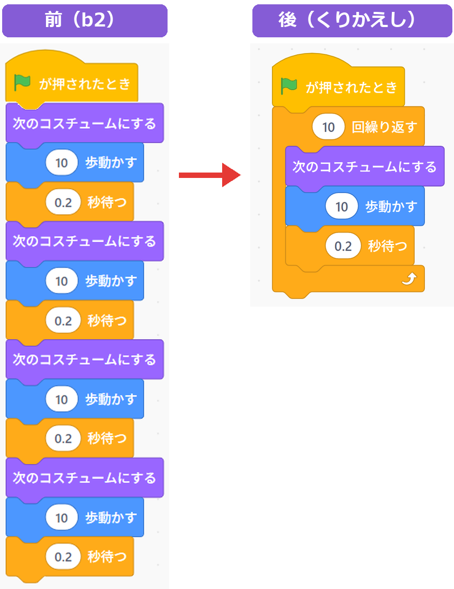

---

# ブロックのはさみかた

:::

「**10 回繰り返す**」は、口があいた形をしているね。

- 口の**中**のブロック … くりかえす
- 口の**下**につないだブロック … くりかえしが**終わってから**1回だけ動く

> つながったブロックのいちばん上を持って口に近づけると、下のブロックもいっしょに入るよ。

:::

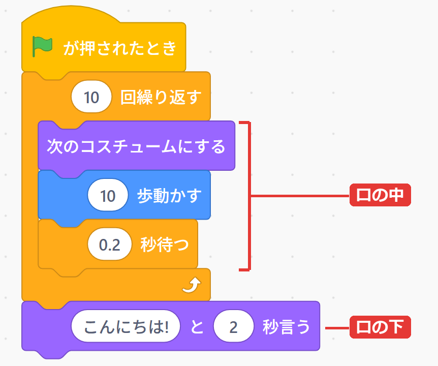

---

# ずっと

:::

「**ずっと**」は、**止めるまで**くりかえすブロック。

1. 「**ずっと**」を緑の旗の下につなぐ
2. 中に「**15 度回す**」を入れる
3. 緑の旗をクリック → ネコが回りつづける
4. **赤いボタン**で止める

> 「ずっと」の下には、ブロックをつなげられないよ。終わりがないからね。

:::

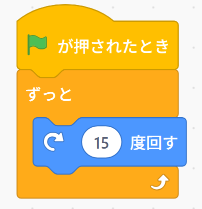

---

# 行ったり来たり

:::

ネコに、ステージの**はしからはしまで**歩かせよう。

1. 緑の旗の下に「**回転方法を 左右のみ にする**」
2. その下に「**ずっと**」
3. 「ずっと」の中に「**10 歩動かす**」と「**もし端に着いたら、跳ね返る**」

> 「**次のコスチュームにする**」と「**0.1 秒待つ**」も中に入れると、歩きながら行ったり来たりするよ。

:::

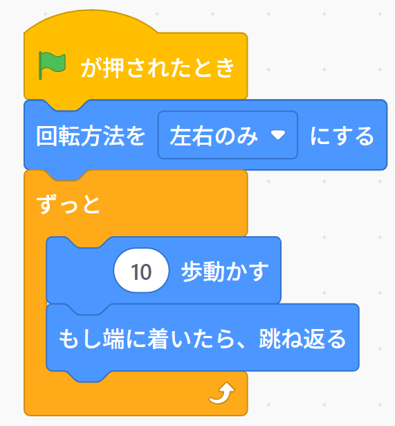

---

# マウスについてくる

:::

1. 緑の旗の下に「**ずっと**」をつなぐ
2. 「**動き**」の「**どこかの場所 へ行く**」を中に入れる
3. 「どこかの場所」の ▼ で「**マウスのポインター**」をえらぶ
4. 緑の旗をクリックして、マウスを動かす

> 「ずっと」の中だから、マウスがどこへ行っても、ずっとついてくるんだ。

:::

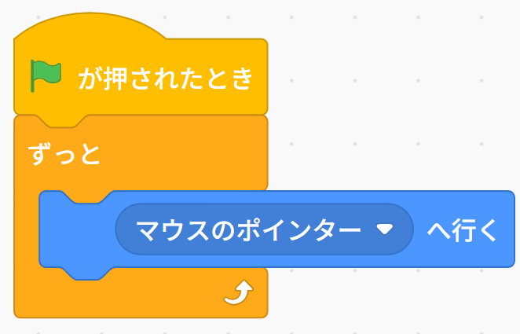

---

# 2つのくりかえしのちがい

:::

- 「**ずっと**」… **終わらない**。赤いボタンで止めるまで続く。だから下が**平ら**で、下にはつなげない
- 「**10 回繰り返す**」… 回数が**決まっている**。終わったら下のブロックへ進む。だから下に**出っぱり**がある

> ゲームでは「**ずっと**」をよく使うよ。ゲームのあいだ、ずっとキャラクターを動かしたいからね。

:::

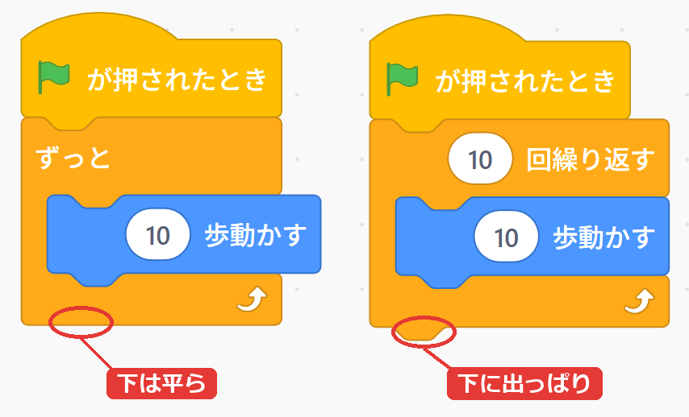

---

# 🎮 ミニゲーム：ネコから逃げろ

:::

**🏃 追いかけ** … ネコがマウスを追いかけてくるよ。逃げきれるかな？

1. 緑の旗の下に「**ずっと**」をつなぐ
2. 中に「**マウスのポインター へ向ける**」と「**3 歩動かす**」を入れる
3. 緑の旗をクリックして、マウスで逃げる
4. **10秒**つかまらなければ勝ち！（となりの人に数えてもらおう）

> 歩数を大きくすると、ネコが速くなるよ。次の章で、つかまったら止まる**本物のゲーム**にするよ。

:::

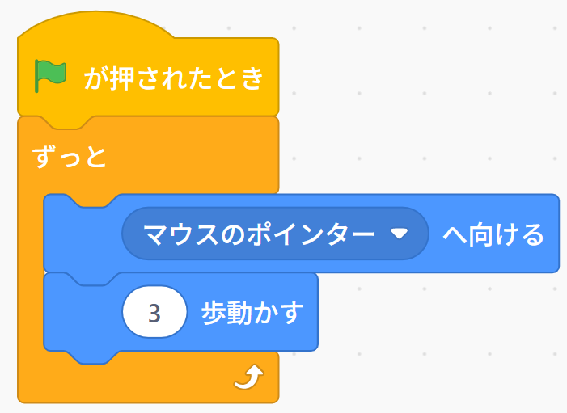

---

# 作品をパソコンに保存しよう

:::

1. 「**ファイル**」をクリック
2. 「**コンピューターに保存する**」をえらぶ
3. ブラウザの右上に、ダウンロードの知らせが出たら OK！

作品は「**ダウンロード**」フォルダに、**Scratchのプロジェクト.sb3** という名前で入るよ。

> ⚠ 何回も保存すると、名前のうしろに (1) (2) と番号がつくよ。番号がいちばん大きいのが、最後に保存したものだよ。

:::

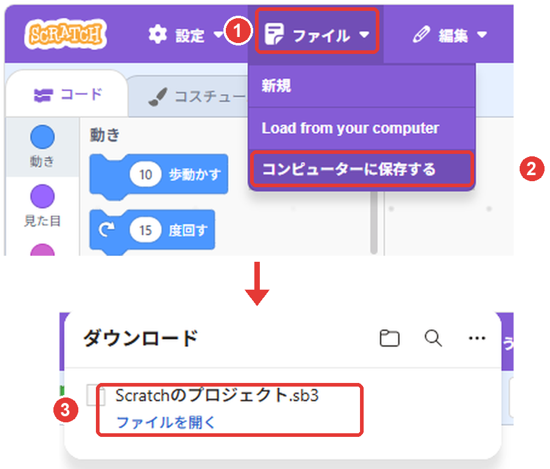

---

# ファイルに名前をつけよう

:::

このままだと、どれが自分の作品かわからなくなるね。わかりやすい名前に変えよう。

1. ダウンロードの知らせで、ファイルにマウスをのせると出る**フォルダーのマーク**をクリック
2. 保存したファイルを**右クリック**して、「名前の変更」をえらぶ
3. 作品の名前を入れる（例：**はじめてのネコ.sb3**）

> ⚠ うしろの **.sb3** は消さないでね。消すと Scratch で読み込めなくなるよ。

:::

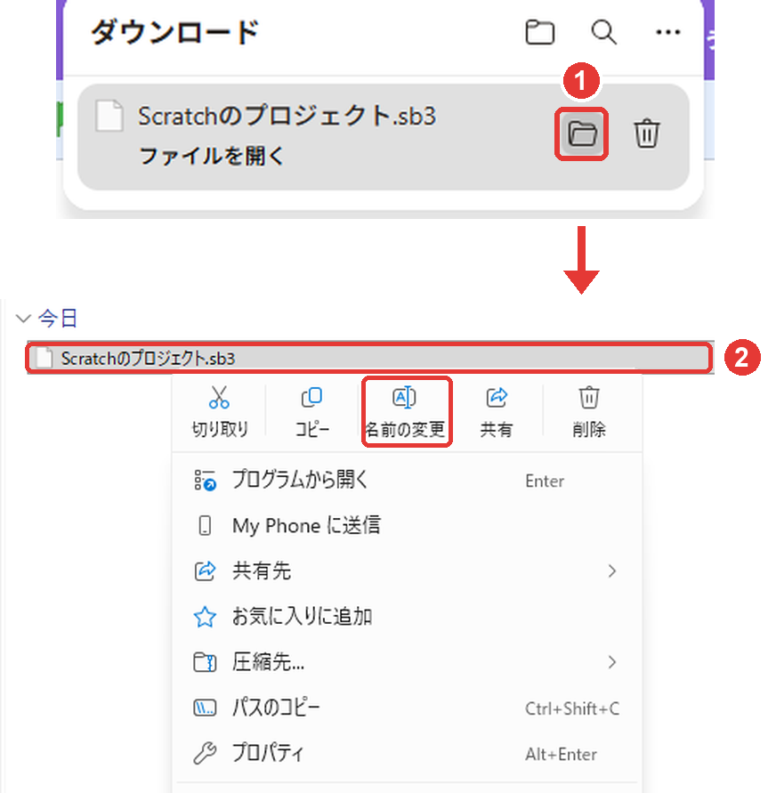

---

# つづきから作るには

:::

次の日に、保存した作品のつづきを作れるよ。

1. エディターをひらく
2. 「**ファイル**」をクリック
3. 「**Load from your computer**」をえらぶ（ここだけ英語で出るよ）
4. 「ダウンロード」フォルダから、保存した **.sb3** のファイルをえらぶ
5. 「開く」をクリック

> ⚠ 読み込むと、いま画面にある作品と入れかわるよ。だいじな作品は、先に保存しておこう。

:::

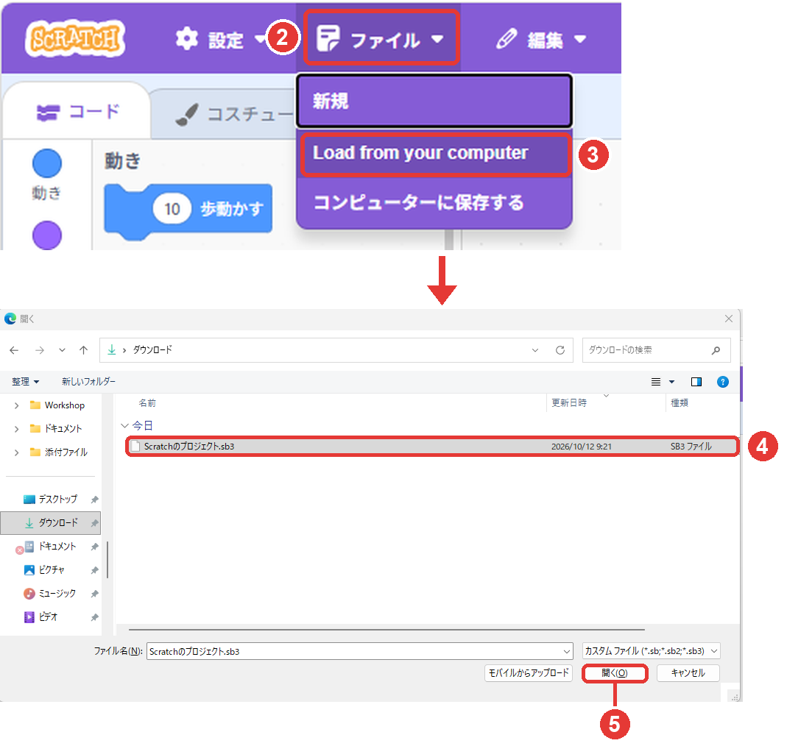

---

# やってみよう

:::

マウスを**追いかけて走る、にじ色のネコ**を作ろう。

1. 緑の旗の下に「**ずっと**」をつなぐ
2. 中に「**マウスのポインター へ向ける**」と「**10 歩動かす**」を入れる
3. 足が動くように「**次のコスチュームにする**」を足す
4. 色が変わるように「**色 の効果を 25 ずつ変える**」を足す
5. 緑の旗で動かしてみて、できたら作品を保存する

> 歩数や色の数字を変えて、自分ごのみのネコにしてみよう。

:::

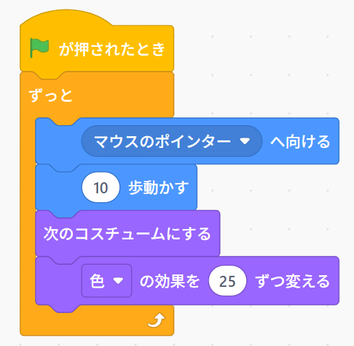
