{cover}
# ③ はじめてのプログラム

ブロックをつなげて、ネコを動かそう

*Scratch 体験ワークショップ*

---

# なにをするの？

:::

いよいよ、**自分でプログラム**を作るよ。

- ブロックを**ドラッグ**して置く
- ブロックを**つなげる**
- **緑の旗**で動かす
- **数字**を変えて、動きを変える

> 使うブロックは3つだけ。かんたんだよ！

:::

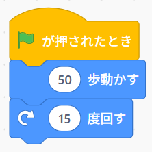

---

# ブロックをクリックしてみよう

:::

1. 「**動き**」をクリック
2. 「**10 歩動かす**」を、まん中の**コードエリア**にドラッグ
3. 置いたブロックを**クリック**
4. ネコが少し右に動いたら成功！

> 動いているあいだ、ブロックのまわりが黄色く光るよ。

:::

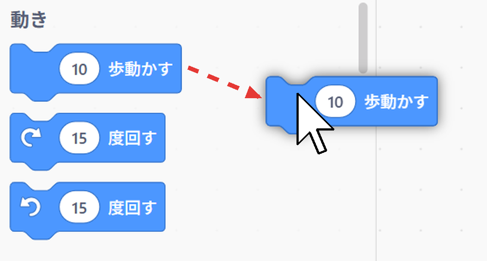

---

# 数字を変えよう

:::

1. 「**10 歩動かす**」の白い丸のところをクリック
2. **50** を入れる
3. ブロックをクリック

ネコの動きが**大きく**なったね。

> 数字を大きくすると遠くへ、小さくすると少しだけ動くよ。

:::

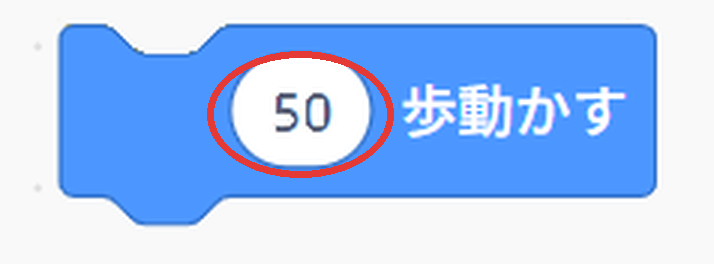

---

# ブロックをつなげよう

:::

1. 「**動き**」の「**15 度回す**」をえらぶ（右回りの矢印のほう）
2. 「**50 歩動かす**」の**すぐ下**に近づける
3. 灰色の影が出たら、はなす → **カチッ！**
4. つながったブロックをクリック

> ⚠ はずすときは、**下のブロック**を持って引っぱるよ。いらないブロックは、左のブロックのならぶところにもどすと消えるよ。

:::

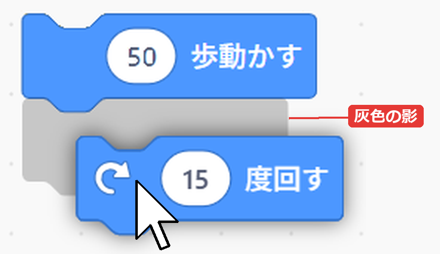
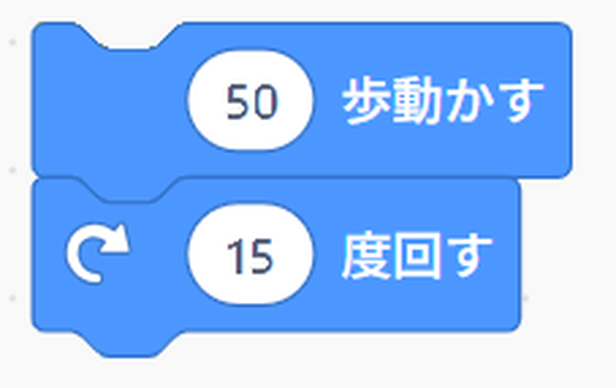

---

# 緑の旗で動かそう

:::

1. 「**イベント**」をクリック
2. 「**（緑の旗）が押されたとき**」を、つないだブロックの**上**にのせる
3. ステージの上の**緑の旗**をクリック

> 緑の旗をクリックするたびに、下のブロックが上から順番に動くよ。止めたいときは、となりの**赤いボタン**を押してね。

:::

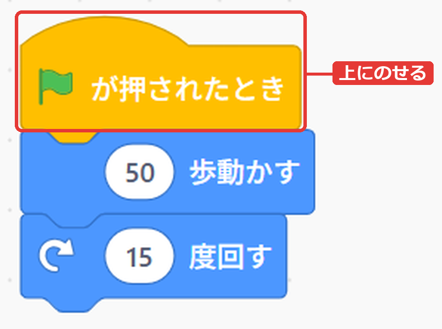

---

# 緑の旗のブロックってなに？

:::

「**（緑の旗）が押されたとき**」は、プログラムの**スタートの合図**を待つブロックだよ。

- 旗のブロックがなくても、ブロックを**クリック**すれば動く
- ブロック1つの働きをためすときは、クリックでOK
- **2つ以上つないだ**プログラムは、いつも**旗のブロックの下**に作って、**緑の旗**で動かそう

> 作品であそぶ人は、緑の旗でスタートするよ。

:::

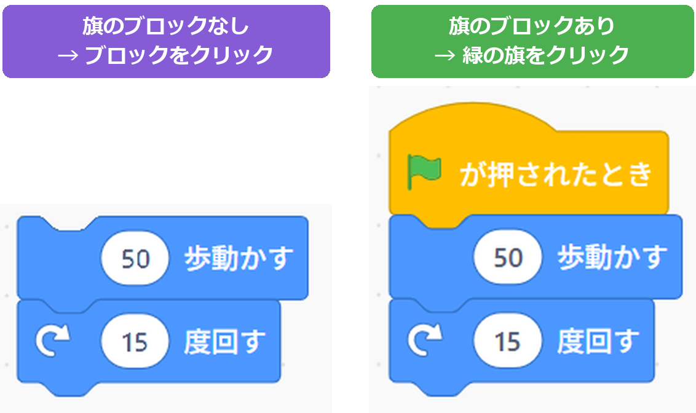

---

# 🎮 ミニゲーム：何回で1周？

:::

**🔮 予想** … 先に予想してから、たしかめよう！

緑の旗を**何回**押すと、ネコが**ぐるっと1周**して、もとの向きにもどるかな？

1. 予想した回数を、となりの人に言う
2. 「**50 歩動かす**」の数字を **0** にする
3. 緑の旗を押しながら、回数を数える
4. もとの向きにもどったら、ストップ！

> 予想がいちばん近かった人の勝ち！ 右下の「**向き**」の数字を見ながらやると、わかりやすいよ。

:::

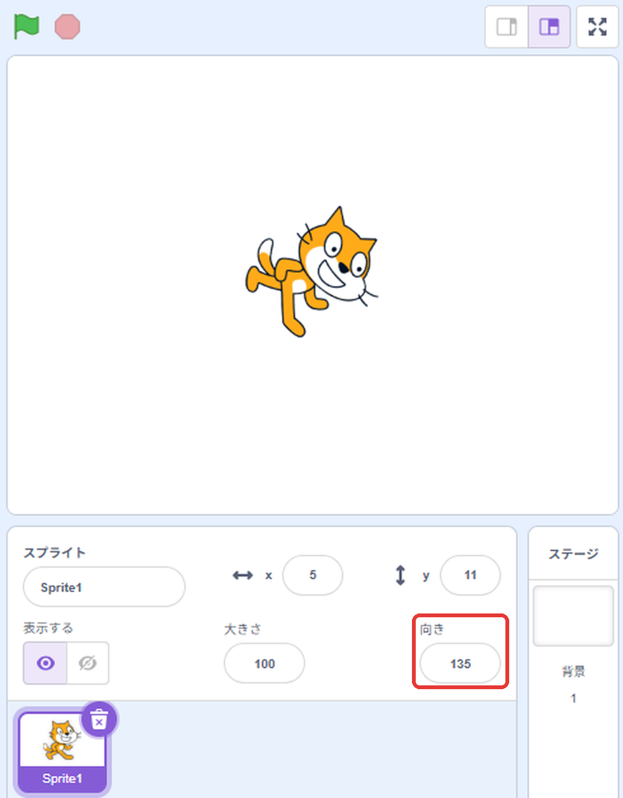

---

# ネコをもとにもどそう

:::

何回も動かすと、ネコがはしっこに行ったり、ななめになったりするね。

1. ステージのネコを**ドラッグ**して、まん中にもどす
2. 右下の「**向き**」をクリック
3. **90** にする → ネコがまっすぐ右を向く

> 次の基本編では、プログラムでもとの場所にもどす方法をおぼえるよ。

:::

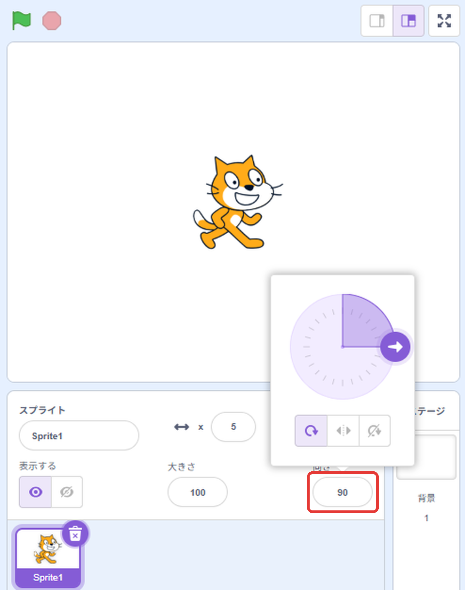

---

# やってみよう

:::

ブロックを変えて、ネコの動きをかえてみよう。

1. 歩く数を **100** にする
2. 回る角度を **90** にする
3. 緑の旗を何回もクリックして、ネコがどう動くか見る

> これで導入編はおしまい！ 次の基本編では、いろいろなブロックを使っていくよ。

:::

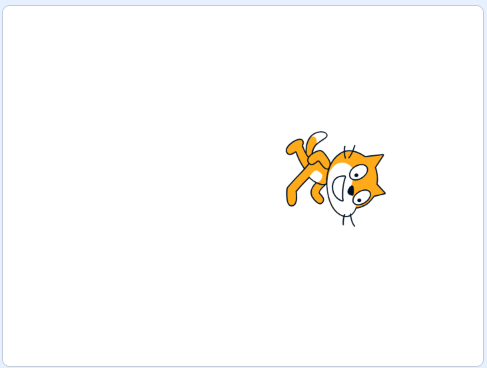
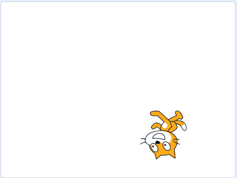
